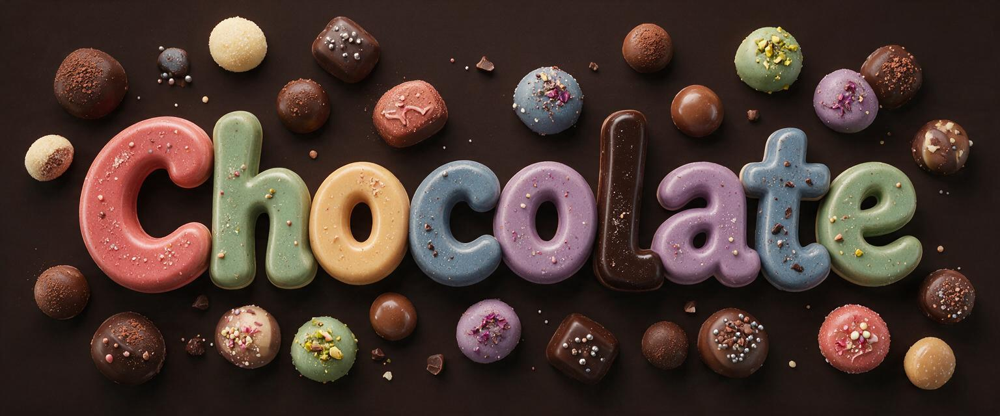
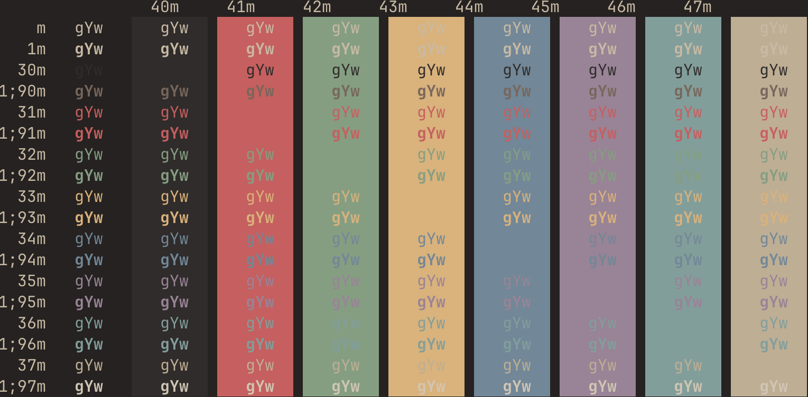

# Chocolate | Ghostty
The Chocolate color scheme for Ghostty.

 

* [Ghostty for macOS and Linux](https://ghostty.org/)

* [Chocolate color palette](https://gitlab.com/snakedye/chocolate) 

 

Place file in ~/.config/ghostty/themes/ (create folders if non-existing).

*Chocolate*

